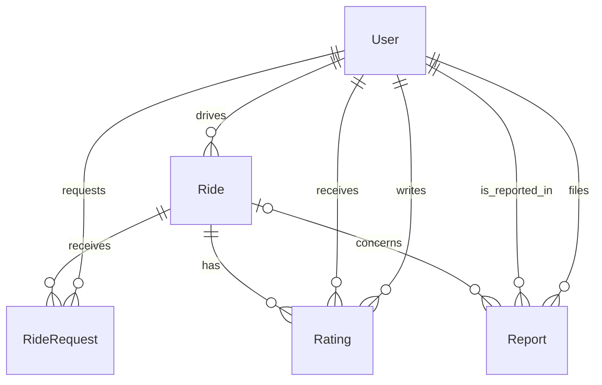

# Manoa Carpool database schema draft (Issue #6)

This draft uses PostgreSQL and Prisma, with the five requested models: `User`, `Ride`, `RideRequest`, `Rating`, and `Report`.

## Design notes

- `User.email` is unique. The application must check that users control a valid UH (`@hawaii.edu`) email; database uniqueness alone does not verify ownership.
- `Role` distinguishes regular users and admins. `homeArea` is optional during onboarding. `rating` caches an average of received scores, and `points` starts at zero.
- Each `Ride` has one driver and can have many `RideRequest` records. `seats` is the number of seats offered. Remaining seats should be calculated from accepted requests, not maintained independently.
- `@@unique([rideId, riderId])` prevents duplicate ride requests by the same user.
- `Rating` records a score for one trip with an author and recipient; the unique constraint stops repeated ratings of the same person for one ride.
- `Report` identifies both the reporter and the reported user, and optionally the related ride.

## Application rules (not guaranteed by this draft schema)

- Only verified UH users may sign in or participate.
- A driver must not request their own ride.
- Seats must be greater than zero, and accepting requests must not exceed capacity. Perform the acceptance operation atomically in a transaction.
- Scores must be integers from 1 through 5. Only eligible ride participants may rate one another after a confirmed ride.
- Points should be awarded only once after both driver and rider confirm that a ride happened.
- Reports should be visible only to authorized admins and the appropriate reporting users.
- Store all dates as proper `DateTime` values and format in the Hawaii time zone in the UI.

## Status

Schema draft only. No deployment, migrations, or seed data are included in Issue #6. If the team starts with Prisma 7, move the connection URL into `prisma.config.ts` as required by that version rather than using the `datasource.url` field in this class-style draft.

### Final Schema Implementation Notes

The final Prisma schema will use `Int` IDs for database records to remain consistent with the existing Next.js application template.

The `User` model will keep the template's `password` field so the existing sign-in system continues to work.

This document is a schema draft. Aaron will implement and test the final Prisma schema as part of Issue #99.